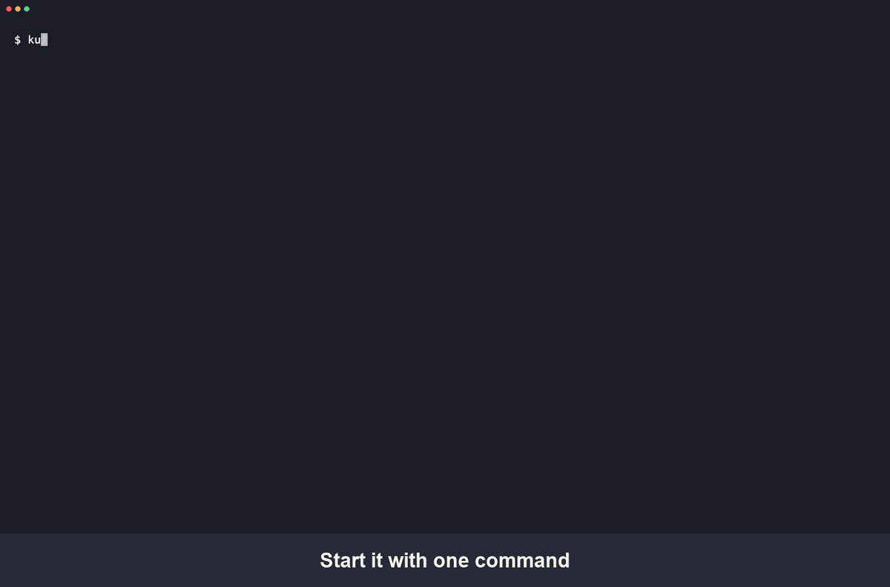
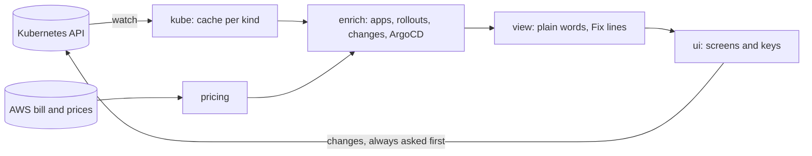

# kubed

**Kubernetes tells you what is running. kubed tells you what is wrong, and how to fix it.**

kubed is a terminal app for running Kubernetes. Open it and you see your
apps, with the broken ones first. For each one it says in plain words what
is wrong (from the pod's status, its events and its last logs) and what to
do next, with the key that does it. Every screen shows the keys that work on
it.



On Amazon EKS it also shows what your cluster and each app cost, from your
own AWS bill and live spot prices.

## Why kubed

- **Apps, not pods.** Pods are grouped into the apps you ship (ArgoCD apps,
  or by Helm and app labels), with the broken ones on top.
- **The reason, not just the status.** "Can't pull image: that image or tag
  doesn't exist", "keeps running out of memory: limit 512Mi", with the error
  line from the crashed run's logs.
- **A Fix line for each problem**, naming the key that does it.
- **What changed, and when.** New versions, go-backs, restarts, scaling and
  crashes on one timeline, worked out from what Kubernetes keeps.
- **Safe on production.** Production shows in red, every change asks you to
  type the name of what you change, and `--readonly` turns changes off.
- **Costs on Amazon EKS**, from your own AWS bill and live spot prices.

### kubed and k9s

[k9s](https://k9scli.io) is a great power tool for browsing every resource
in a cluster, and many people use both. They answer different questions:

| | k9s | kubed |
|---|---|---|
| Starts on | a list of one resource kind | your apps, broken ones first |
| Tells you | each resource's status | what is wrong, why, and what to do next |
| Crash reason | open the logs and look | the error line from the last run, in the app's box |
| History | not kept | what changed in the last 24 hours, per app |
| Production safety | read-only mode | red frame, typed names for every change, read-only mode |
| ArgoCD, ExternalSecrets, Karpenter | shown as resources | part of the app's health and its Fix line |
| Cost | not built in | per cluster, per node, per app on EKS |
| Best for | exploring any resource, plugins, XRay and Pulses views | finding and fixing what is broken, fast |

### How it works



kubed watches only the kinds the screen needs and keeps them in a local
cache, so drawing the screen never waits on the cluster. It talks only to
your cluster's API server (and AWS for costs), using your own kubeconfig.

## Install

With Homebrew (macOS and Linux):

```bash
brew install s3cretagent/tap/kubed
```

Or with Go: `go install github.com/s3cretagent/kubed/cmd/kubed@latest`. From a
copy of the code: `make install`. Builds for macOS and Linux are also on the
[releases page](https://github.com/s3cretagent/kubed/releases).

## Start

```bash
kubed                          # your current cluster (the same one kubectl uses)
kubed --readonly               # look around; nothing can be changed
kubed --context staging        # another cluster from your kubeconfig, by
                               # its name or part of it
```

Inside kubed, **:ctx** lists your clusters (production ones marked) and
**:ns** your namespaces. The header always says which cluster you are on.

The five keys to know:

| Key | What it does |
|---|---|
| enter | open a row, or see everything you can do with it |
| esc | go back |
| f | find anything by name |
| ? | help |
| q | quit |

## Learn more

- **[Using kubed](docs/GUIDE.md)**: everyday use, fixing problems, logs,
  making changes safely, production clusters, costs, and what to do when it
  can't connect.
- **[How kubed works](docs/DEVELOPMENT.md)**: building, testing and the
  details behind what it shows.
